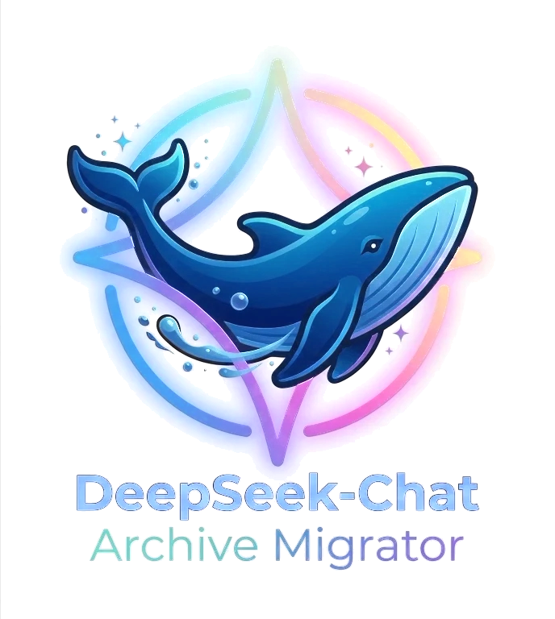

<p align="center">
  
</p>

# DeepSeek Chat Archive Migrator (with Image Hosting & Persona Continuity)

A lightweight, zero-dependency Python toolkit to migrate exported **DeepSeek** chat histories (`chat_sessions/*.json`) into **Google Gemini** (via the ChatGPT-compatible `conversations.json` import format) or organize them as clean, human-readable individual JSON files.

## Why this exists
When exporting data from DeepSeek, chats are stored as cryptic UUID-named JSON files with local relative paths to uploaded images/attachments. Standard importers either drop local attachments or lose the conversational tone/persona when continuing a chat in another LLM.

This toolkit solves five problems in one go:
1. **Tree-accurate message reconstruction:** Traverses DeepSeek's `parent_id` message graph in exact chronological order.
2. **Clear title prefixing:** Automatically prefixes every imported conversation title with `DeepSeek - <Chat Title>` (configurable via `CHAT_PREFIX`) so imported archives stay visually distinct from native Gemini chats.
3. **Self-hosted attachment mapping:** Renames and organizes all exported images/files into clean folders, rewrites links inside the chat messages to point to your own web host (e.g., InfinityFree, GitHub Pages, S3, or any static host), and generates randomized `403 Forbidden` `index.html` files to prevent directory indexing.
4. **Persona & style continuity anchor:** Optionally appends a customizable User/Assistant handover pair at the end of each imported chat so the target LLM immediately picks up the established tone, form of address, and style without manual re-prompting.
5. **Individual readable exports:** Includes a second script to split/rename the raw UUID files into clean titles (`DeepSeek_<Chat_Title>.json`) with updated URLs for local archiving or RAG/knowledge-base workflows.

---

## Folder Structure

Place both scripts in the root directory of your unzipped DeepSeek export:

```text
deepseek-export/
├── chat_sessions/               # Original exported UUID .json files from DeepSeek
├── <exported_asset_folders>/    # Original image/file folders referenced by export_path
├── build_gemini_import.py       # Script 1: Builds Gemini import ZIP + upload folder
└── export_individual_chats.py   # Script 2: Exports clean, individual named JSON files
```

---

## Quick Start

### 1. Configure your hosting URL
Open `build_gemini_import.py` (and `export_individual_chats.py` if needed) and set your target base URL where you will upload the assets:

```python
BASE_URL = "[https://example.com/ds_archive](https://example.com/ds_archive)"
```

*(Optional)* Customize `CHAT_PREFIX` (default: `"DeepSeek - "`) or uncomment `ANCHOR_USER_PROMPT` and `ANCHOR_ASSISTANT_REPLY` in `build_gemini_import.py` to match the persona or instructions you want carried over into Gemini.

### 2. Run the Migration Builder
Run `build_gemini_import.py` (double-click on Windows or `python build_gemini_import.py`). It generates:
* `htdocs_upload/` – Ready to upload via FTP (e.g., FileZilla) to your web server. Contains cleanly renamed images (`DeepSeek_<Chat_Title>_001.png`) and randomized `403 Forbidden` `index.html` files in every subfolder.
* `import_all_chats.zip` – Contains `conversations.json` with all chats prefixed as `DeepSeek - <Chat Title>`, ready for import into Gemini.
* `test_web_chat.zip` – A single-chat ZIP containing at least one image link so you can verify your setup before importing the full archive.

### 3. Upload Assets & Import
1. Upload the contents of `htdocs_upload/` to your web server using an FTP client (recommended over browser-based file managers to avoid timeouts on large asset folders).
2. Test `test_web_chat.zip` first to verify image links resolve properly (note: Gemini enforces a daily import count limit, so batching everything into `import_all_chats.zip` counts as a single import).
3. Import `import_all_chats.zip`.

---

## Bonus: Individual Named JSON Files
If you prefer individual files rather than a single merged archive (for local backups or custom knowledge bases), run `export_individual_chats.py`. It outputs human-readable files into `single_chats_named/` (`DeepSeek_<Chat_Title>.json`) with all attachment URLs updated to match your hosted structure.

## Requirements
* Python 3.9+ (uses standard library modules only: `json`, `pathlib`, `re`, `shutil`, `zipfile`, `urllib.parse`, `datetime`, `random`).

## Note
* The scripts and README were co-authored with Gemini and inspired by the feeling of loss caused by the recent restrictions on DeepSeek.
