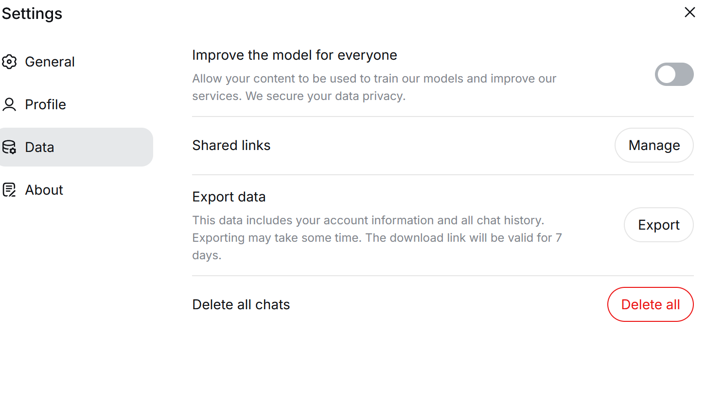
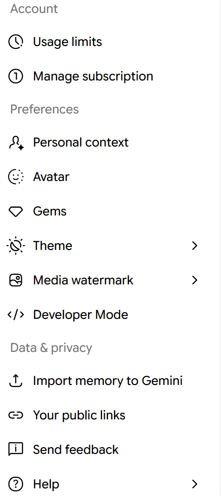

## Step-by-Step Guide (No Coding Experience Required)

### 1. Install Python (One-Time Setup)
* **Windows:** Open the **Microsoft Store**, search for **Python**, and click **Install**.
* **Mac:** Download the latest installer from [python.org/downloads](https://www.python.org/downloads/) and run it.

### 2. Export Your DeepSeek Chats
1. Open DeepSeek and click your **username** in the bottom-left corner.
2. Go to **Settings → Data** and click **Export** next to *Export data*.
3. Wait for the email from DeepSeek and download the `.zip` file (note: the download link is valid for 7 days).

### 3. Unpack Both ZIP Files into One Folder
1. Create a new folder on your Desktop (for example, `DeepSeek-Migration`).
2. Extract your **DeepSeek export `.zip`** into that folder (you should see a `chat_sessions` folder inside it).
3. Download this repository (**Code → Download ZIP**) and extract its files (`migrate.py`, etc.) into that **exact same folder**.

### 4. (Optional) Upload Your Images
* *Only needed if your chats contain uploaded images and you want them visible inside Gemini:*  
  Upload your extracted image folder to any free image/file host (or personal web space) and copy the base URL. *(If you skip this step, all your text conversations still migrate cleanly.)*

### 5. Run the Converter
* **Windows:** Double-click `migrate.py` (or right-click inside the folder → **Open in Terminal** and type `python migrate.py`).
* **Mac / Linux:** Open Terminal in that folder and run `python3 migrate.py`.
* Follow the on-screen prompts—it will generate a new `.zip` file containing your converted `conversations.json`.

### 6. Import into Gemini
1. Open [gemini.google.com](https://gemini.google.com) and click **Settings & help** in the bottom-left corner.
2. Under **Data & privacy**, click **Import memory to Gemini**.
3. Upload the **newly generated `.zip` file** (up to 5 GB).

